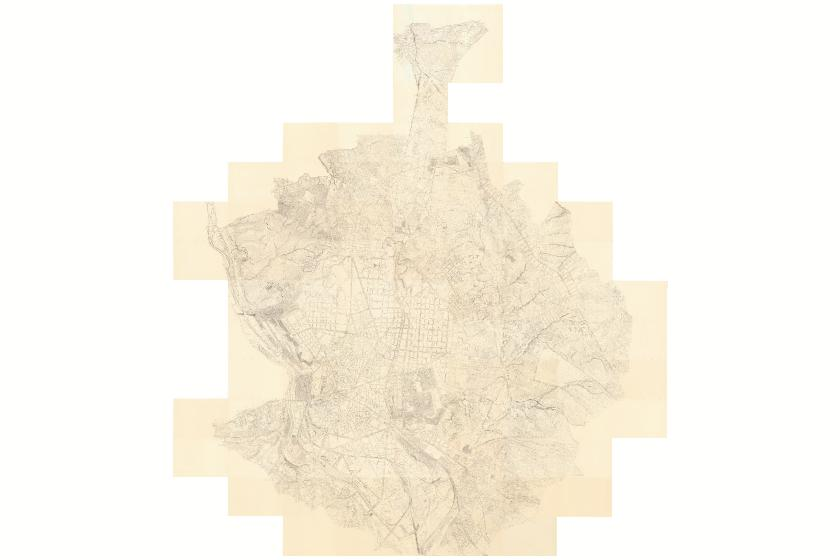

# Madrid a través del tiempo

[Explore the maps at madrid.luischav.es](https://madrid.luischav.es)

Browse twelve historical maps of Madrid from 1622 to 1960, compare any two with a sliding divider or overlay, and search for present-day streets, addresses and neighbourhoods. No account is required.

The website is in Spanish. Primary controls combine icons with visible text, and each map has short questions, answers and historical curiosities in its information panel.



## Use

**Mapas** opens all maps; **Comparar** lets you choose two dates. Use **Buscar dirección** to find an address, **Ampliar mapa** to explore without page borders, and **Llenar pantalla** or **Plano completo** to change the fit.

**Información** opens the illustrated horizontal timeline. Tap a map to select it and read why it was made, followed by short questions and curiosities. Original catalogue descriptions and additional archive collections are available below. The timeline includes all twelve historical maps plus today's reference map; additional archive scans are linked separately.

## Saved tiles

Tiles download directly from IGN or Ayuntamiento de Madrid as you explore. Each browser saves up to **64 MiB** of image data across both providers, discarding older tiles when full. There is no server-side tile archive or bulk download. Up to six new tile downloads run at once.

Saved tiles can survive closing the browser. Use **Información → Borrar imágenes guardadas** to remove them. Browser storage settings may also clear or disable the cache.

## Sources

IGN cartography and previews are credited **CC BY 4.0 ign.es**. The [1889 copy of Carlos Colubi’s cadastral atlas](https://geoportal.madrid.es/IDEAM_WBGEOPORTAL/dataset.iam?id=SPA_28079_SERIE_CARTOTECA_1889_Carlos_Colubi_1890) comes from **Ayuntamiento de Madrid / memoriademadrid**, under the [municipal reuse conditions](https://datos.madrid.es/pages/condiciones-generales-ayuntamiento-de-madrid). Its sheets describe the surrounding land parcels and leave a real gap over the old city.

Geographic alignment is supplied by the providers and is approximate for older surveys. The 1940–1960 collection contains gaps between sheets. See [map sources and dates](docs/map-sources.md) for the distinction between individual city plans, archive scans and repeated national mapping.

Search uses [CartoCiudad](https://www.cartociudad.es/) addresses and [OpenStreetMap](https://www.openstreetmap.org/copyright) places through [Photon](https://github.com/komoot/photon). Availability depends on those public services. Leaflet 1.9.4 is vendored with its licence.

See the [viewer FAQ](docs/faq/README.md) for alignment, source detail, held-pinch loading and caching questions.

<details>
<summary>Development and deployment</summary>

Requires Bun. Run from the repository root:

```sh
BROWSER=/usr/bin/true bun preview.mjs
bun test
```

Open `http://127.0.0.1:18894/`. The preview accepts only local read requests. `roborev init` installs local review hooks after cloning.

Deploy static assets with `bunx wrangler deploy`, using an existing `CLOUDFLARE_API_TOKEN` in the shell. Never commit credentials. `wrangler.jsonc` configures the custom domain; workers.dev and version previews are disabled.

The browser scripts exercise live tiles, gallery/comparisons, address search, cache clearing and held pinch zoom in an isolated browser. `bun test` covers search and the tile worker, including cache bounds, retries and clearing while downloads are in flight. Native physical-iPad Safari remains a separate device check.

The IGN catalogue comes from [the original web map](https://nco.ign.es/portal/home/webmap/viewer.html?webmap=8eda9d617ce540778acf62c0b9fcfed1) and [WMTS capabilities](https://www.ign.es/wmts/planos?SERVICE=WMTS&REQUEST=GetCapabilities). Colubi uses the municipal WMS in EPSG:3857, with bounds advertised by its capabilities. `bun fetch-previews.mjs` retrieves genuine WMS previews; pass a map ID, such as `ColubiMadrid`, to update only that preview. `check-timeline.js` exercises timeline selection, context, scrolling, keyboard access and real Colubi tiles. `PLAN.md` retains the implementation and deployment history.

</details>
